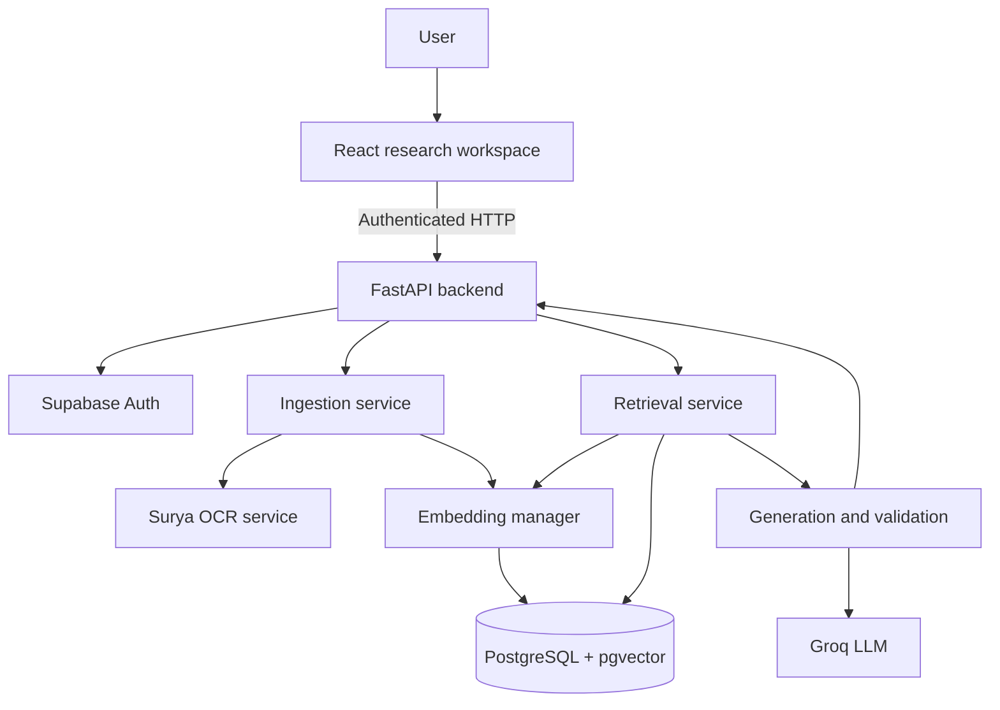
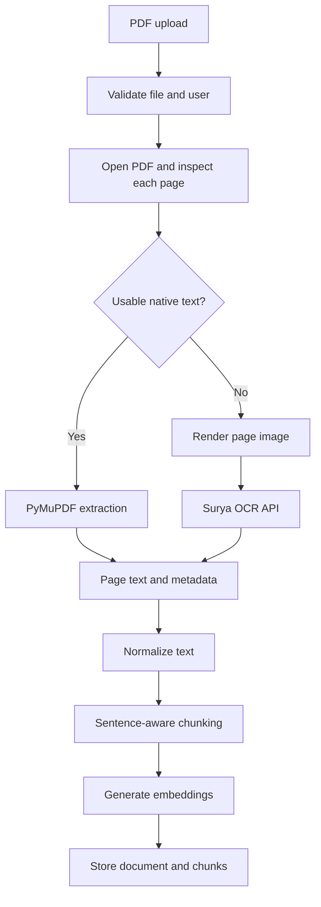
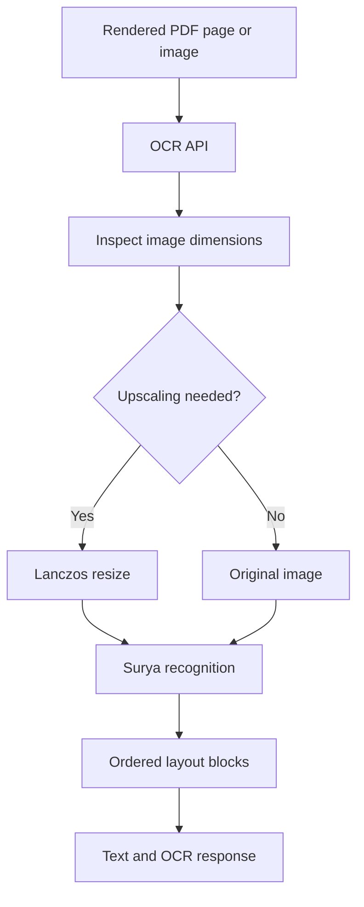
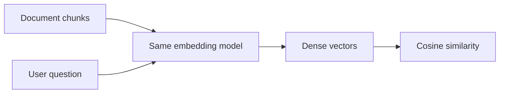
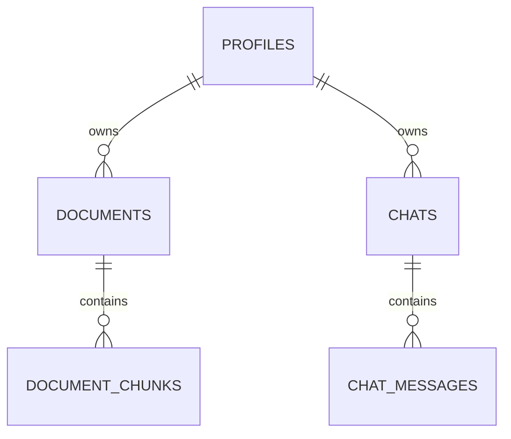
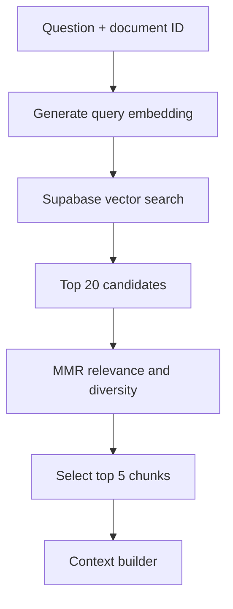
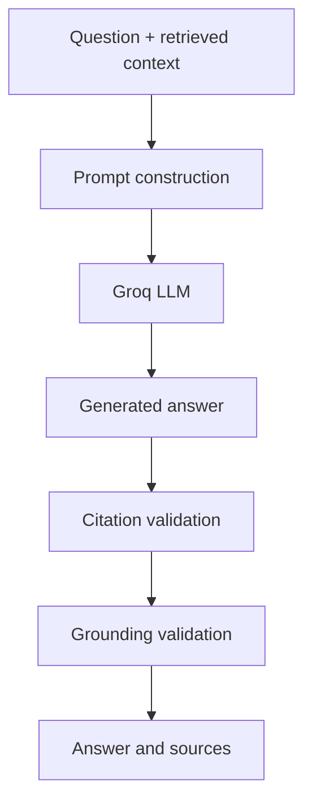
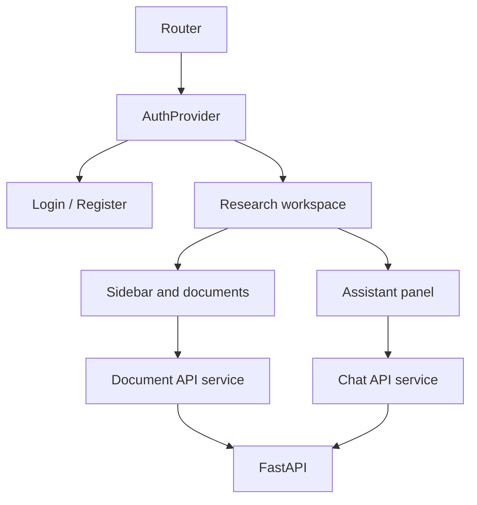

# LegalMind AI

**Citation-aware legal research and document intelligence for Indian legal documents.**

LegalMind AI is a full-stack Retrieval-Augmented Generation (RAG) application that enables users to upload legal documents, search their contents semantically, and ask questions with page-level source citations. It combines native PDF extraction, an independent OCR service, vector retrieval, and an LLM-based answer generation pipeline.

> **Development status:** Working research prototype. English document ingestion and retrieval are operational. Hybrid PDF extraction with Hindi OCR has been demonstrated in isolated parser tests. Full multilingual retrieval and production-grade OCR orchestration remain in development. Generated responses are research assistance, not legal advice.

## Contents

- [Capabilities and status](#capabilities-and-status)
- [Technology stack](#technology-stack)
- [System architecture](#system-architecture)
- [Repository map](#repository-map)
- [Document ingestion architecture](#document-ingestion-architecture)
- [OCR microservice](#ocr-microservice)
- [Embedding architecture](#embedding-architecture)
- [Database architecture](#database-architecture)
- [Retrieval architecture](#retrieval-architecture)
- [Answer generation and grounding](#answer-generation-and-grounding)
- [API and authentication](#api-and-authentication)
- [Frontend architecture](#frontend-architecture)
- [Local development](#local-development)
- [Testing and evaluation](#testing-and-evaluation)
- [Operational considerations](#operational-considerations)
- [Architectural decisions](#architectural-decisions)
- [Roadmap](#roadmap)
- [Development workflow](#development-workflow)

## Capabilities and status

| Capability | Status |
| --- | --- |
| Registration, email verification and authentication | Implemented |
| PDF upload and document listing | Implemented |
| Native PDF text extraction | Implemented |
| Normalization and sentence-aware overlapping chunking | Implemented |
| English semantic vector search and MMR | Implemented |
| Document-scoped conversational research and source citations | Implemented |
| Chat history and saved conversations | Implemented |
| Hindi/English scanned page OCR | Tested independently |
| Mixed digital / scanned PDF routing | Tested independently |
| OCR layout blocks, including detected tables | Available in service output; downstream table handling pending |
| OCR metadata propagation through ingestion and storage | Pending verification / integration |
| Cross-language semantic search | Benchmarking planned |
| Background ingestion, retry and progress reporting | Planned |
| DOCX and additional document formats | Planned |

## Technology stack

| Layer | Technology | Responsibility |
| --- | --- | --- |
| Client | React, Vite, React Router, Tailwind CSS | Research workspace, authentication and document UI |
| API | Python 3.12, FastAPI, Uvicorn, Pydantic | HTTP contracts, orchestration and validation |
| Native extraction | PyMuPDF | PDF text and page rendering |
| OCR | Surya OCR 2.5, llama.cpp, Pillow | Scanned page recognition and adaptive upscaling |
| OCR experiments | Tesseract, EasyOCR, Groq vision | Comparative recognition benchmarks |
| Embeddings | SentenceTransformers, BAAI/bge-base-en-v1.5 | 768-dimensional dense vectors |
| Data | Supabase, PostgreSQL, pgvector | Documents, chunks, embeddings, user data and chats |
| Authentication | Supabase Auth | User identity and access tokens |
| Retrieval | Cosine similarity, MMR | Candidate search and diversity-aware selection |
| Generation | Groq, configurable LLM | Context-conditioned answer generation |
| Evaluation | Python evaluation scripts | Retrieval, answer quality, OCR accuracy and latency |

## System architecture



The backend owns the application workflow. The client never needs to manage vector search, OCR model loading or prompts directly. The OCR subsystem runs as a separate service so its heavy dependencies, inference requirements and lifecycle can be managed independently of the API.

There are two distinct workloads:

- **Ingestion:** transform an uploaded document into searchable, traceable chunks. This runs once per ingestion or re-indexing operation.
- **Question answering:** retrieve existing chunks and generate an answer. The PDF does not need to be parsed or embedded again for each question.

## Repository map

The following is a navigation map of the known modules, not an exhaustive filesystem listing. Check `git ls-files` against the current branch if a module has been moved.

```text
LegalRag/
├── README.md
├── .gitignore
├── backend/
│   ├── main.py                      # FastAPI application entry point
│   ├── api/
│   │   ├── routes/                 # Authentication, document and chat HTTP routes
│   │   ├── dependencies/           # Request authentication and shared dependencies
│   │   └── schema/                 # Request/response models
│   ├── services/
│   │   ├── ingestion_service.py    # Document processing orchestration
│   │   └── rag_service.py          # Question-answering orchestration
│   ├── database/
│   │   ├── supabase.py             # Database and authentication clients
│   │   └── document_repository.py  # Document persistence
│   ├── rag/
│   │   ├── ingestion/
│   │   │   ├── parser.py            # PDF page extraction and routing
│   │   │   ├── normalize.py         # Text cleanup
│   │   │   ├── chunking.py          # Chunk creation and metadata
│   │   │   ├── loaders/             # File loaders / OCR experiments
│   │   │   └── evaluation/          # OCR metrics and benchmark results
│   │   ├── embeddings/
│   │   │   └── embedding_manager.py # Document and query embeddings
│   │   ├── retrieve/               # Search repository, MMR and retrieval service
│   │   ├── generation/             # Context, prompts, LLM and validators
│   │   └── test/                    # Document/image test fixtures
│   └── evaluation/                 # Retrieval and answer quality benchmarks
├── client/
│   ├── src/
│   │   ├── components/              # Reusable interface components
│   │   ├── context/                 # Authentication state
│   │   └── services/                # Backend API calls
│   └── package.json
├── ocr-service/
│   └── app/
│       └── main.py                  # Separate OCR FastAPI service
└── tools/                           # Local inference binaries (not tracked)
```

### Where to start reading the code

| Question | Entry point |
| --- | --- |
| How does the backend start? | `backend/main.py` |
| What happens after a PDF is uploaded? | `api/routes/documents.py` → `services/ingestion_service.py` |
| How do scanned pages become text? | `rag/ingestion/parser.py` → `ocr-service/app/main.py` |
| How is text split and embedded? | `rag/ingestion/normalize.py` → `chunking.py` → `rag/embeddings/embedding_manager.py` |
| How does a question find relevant content? | `rag/retrieve/retrieval_service.py` → search repository → MMR |
| How is a final answer formed? | `services/rag_service.py` → `rag/generation/context_builder.py` → generation and validators |
| How is quality measured? | `backend/evaluation/` and `rag/ingestion/evaluation/` |

## Document ingestion architecture



### 1. Upload and page routing

The document endpoint accepts PDFs up to 20 MB. The parser inspects pages individually because a single legal PDF may contain digitally generated pages, scanned annexures and mixed languages. A native text layer is preferred when usable. Image-only pages are routed to the OCR service. This avoids running costly OCR across every page.

The hybrid parser was tested on a three-page fixture: digital English → scanned Hindi → digital English. All three pages were routed correctly. Integration of this parser into the upload-to-database path should be reverified before treating OCR-assisted ingestion as complete.

### 2. Text normalization

Normalization prepares extracted text for retrieval without rewriting its substantive meaning. Existing handling includes Unicode NFKC normalization, line-ending normalization, selected invisible character removal, page-number cleanup, bullet cleanup, line-wrap repair and paragraph preservation. Hyphenation exceptions help avoid corrupting terms.

Legal numbers, sections, dates, names and meaningful punctuation must remain intact. Hindi combining marks and sentence boundaries require dedicated regression tests. Keep the source PDF as the authoritative reference; OCR and normalized text are derived representations.

### 3. Chunking

Current settings: `chunk_size=450` characters and `overlap=60` characters. The chunker attempts sentence-aware splitting, handles certain legal abbreviations, and falls back to word-level splitting for oversized passages. Retrieval text may include document/title context to improve semantic search.

Chunks retain page-level provenance and identifiers such as `p012_c01`. A logical chunk record contains text, retrieval text, chunk ID and metadata. The following illustrates the **target** extraction metadata contract; preservation of OCR-specific fields is pending verification:

```json
{
  "chunk_id": "p002_c01",
  "text": "अगली सुनवाई की तिथि 25.05.2025 निर्धारित की जाती है।",
  "metadata": {
    "page_number": 2,
    "source": "hybrid_test.pdf",
    "page_type": "scanned",
    "extraction_engine": "surya"
  }
}
```

## OCR microservice

The OCR service runs independently on port `8001`. It receives an image using a multipart upload (`POST /ocr`), applies adaptive preprocessing, runs Surya and returns recognized text plus layout blocks.



The service uses adaptive Lanczos upscaling to improve recognition on small inputs. In one Hindi test, a 448 × 697 image was enlarged to 1344 × 2091 and produced substantially more readable text than the original. Upscaling cannot recover missing detail and must not be mistaken for a guarantee of OCR accuracy.

Surya returns structural information such as reading order, block label, HTML and bounding boxes. Some test outputs show recognized table structures. Retaining structured tables and mapping coordinates back to the source page are future integration work. The service response includes fields such as engine, filename, total pages, execution time, page text and blocks.

### Why not an LLM spelling-correction stage?

Automatic rewriting can silently change case numbers, statutory references and factual statements. The current design prioritizes improved image preprocessing and faithful transcription. Any future correction layer should preserve raw OCR, explicitly track changes and use verification rather than silently replacing source text.

### Runtime dependencies

Surya runs in a separate `surya-venv` with llama.cpp inference. The GGUF model and multimodal projection weights are downloaded separately and must not be committed. Windows testing exposed a subprocess-management issue involving `os.WNOHANG`; manually running the inference server and attaching Surya to it was the workaround.

CPU OCR is a known bottleneck: a hybrid test took approximately 279 seconds with one scanned page. A dedicated worker, queue, timeout and retry policy are important production requirements.

## Embedding architecture

The embedding manager encodes document retrieval text and user questions into a common vector space. Current English retrieval uses `BAAI/bge-base-en-v1.5` with 768-dimensional vectors. Cosine similarity compares vectors, not literal word equality.



Multilingual extraction does **not** automatically imply multilingual retrieval. The proposed upgrade is to benchmark `intfloat/multilingual-e5-small` and `intfloat/multilingual-e5-base` against the existing BGE baseline. E5 requires appropriate query and passage prefixes. E5-base is attractive because its vector dimension matches the current database schema, but retrieval quality must be measured before migration.

**Migration invariant:** never compare vectors generated by different embedding models as though they belong to the same space, even if their dimensions match. After selecting a candidate, build a separate index or re-embed every stored chunk from canonical retrieval text and switch query encoding consistently. Preserve the stable index until the new one passes evaluation.

## Database architecture

Supabase hosts PostgreSQL and the pgvector extension. Application repositories encapsulate persistence and vector search.



This diagram describes logical ownership rather than asserting every physical foreign-key constraint. Consult the actual database schema for deployed column definitions and policies.

| Table | Role |
| --- | --- |
| `profiles` | Application user profile associated with Supabase identity |
| `documents` | Document identity, filename, ingestion state and ownership |
| `document_chunks` | Chunk ID, content, metadata and 768-dimensional embedding |
| `chats` | Conversation records and saved state |
| `chat_messages` | User and assistant conversation messages |

The chunk identity is unique per `(document_id, chunk_id)`. `idx_document_chunks_document_id` supports document filtering. The database search RPC `match_document_chunks` accepts an embedding, requested candidate count and optional document ID filter. It ranks by cosine distance (`<=>`) and returns similarity as `1 - distance`.

The current design stores source metadata but the earlier implementation did not persist the original PDF path (`file_path` was null). Durable source-file storage and source inspection are therefore separate production concerns, particularly for legal citations and reprocessing.

## Retrieval architecture



1. The retrieval service embeds the question using the same model used at ingestion.
2. The search repository calls the pgvector RPC, optionally filtering by the selected document.
3. Maximal Marginal Relevance (MMR) selects a smaller set of useful, less redundant chunks. The current configuration is 20 candidates, 5 selected results and `lambda=0.7`.
4. Context construction attaches source labels and page references.

MMR balances query relevance against similarity to already selected chunks. It is particularly useful when adjacent overlapping chunks contain near-identical text. An optional cross-encoder reranking strategy has been explored but is not assumed to be part of the default pipeline.

## Answer generation and grounding



The generation layer is configured through `GROQ_MODEL_NAME` (the development default has been `openai/gpt-oss-120b`). `ContextBuilder` assembles the retrieved passages and source identifiers; the generation service instructs the LLM to answer from provided evidence and cite it.

Citation validation checks whether references resolve to known retrieved sources. Grounding validation checks support against supplied context. A syntactically valid citation is not proof that the cited passage supports a claim, so both checks serve distinct purposes. If sufficient evidence is missing, the system should express uncertainty rather than fabricate an answer.

These checks reduce unsupported output but do not guarantee legal correctness. Human review against the original legal document remains essential.

## API and authentication

The API is exposed through FastAPI with interactive OpenAPI documentation at `/docs`. Existing application routes use the `/api/v1` prefix.

| Method | Route | Responsibility |
| --- | --- | --- |
| POST | `/api/v1/auth/register` | Create user account |
| POST | `/api/v1/auth/login` | Authenticate user |
| GET | `/api/v1/auth/me` | Resolve authenticated user |
| POST | `/api/v1/documents/upload` | Upload and ingest PDF |
| GET | `/api/v1/documents/list` | List documents with pagination |
| POST | Chat endpoint (see `/docs`) | Ask a question against a selected document |

Conversation history and saved-chat operations are also implemented; consult OpenAPI for the exact routes and payloads on the current branch. The separate OCR API exposes `POST /ocr`.

Supabase Auth manages registration, email verification and access tokens. Protected endpoints use bearer authentication. Production authorization must enforce document and chat ownership at each route/repository boundary; a client-supplied document ID alone is not an authorization check. Verify Supabase row-level security and service-key usage explicitly.

## Frontend architecture

The React/Vite client presents a research workspace with authenticated routes, document selection, upload progress, conversation rendering and saved conversations.



Authentication state is managed through `AuthProvider`; the current client uses session storage for tokens. Research routes include `/research` and `/research/:chatId`. The document and chat service modules isolate HTTP calls from presentation logic. Research modes include document questions, summarization and judgment analysis controls; additional modes such as web research and judgment comparison should be considered interface/roadmap features until their full backing logic is verified.

## Local development

### Prerequisites

- Python 3.12 and a virtual environment for the backend.
- Node.js and npm for the React client.
- A Supabase project with pgvector, required tables, vector-search RPC and authentication configured.
- Groq API credentials.
- Optional for scanned documents: independent Surya environment, compatible llama.cpp server binary and downloaded model weights.

### 1. Backend (PowerShell)

```powershell
cd backend
python -m venv venv
.\venv\Scripts\Activate.ps1
pip install -r requirements.txt
```

Use the repository's dependency manifest if its name differs. Do not reuse the OCR virtual environment for the main backend.

Create `backend/.env` from the existing configuration requirements:

```dotenv
SUPABASE_URL=your_supabase_project_url
SUPABASE_KEY=your_backend_supabase_key
GROQ_API_KEY=your_groq_api_key
GROQ_MODEL_NAME=openai/gpt-oss-120b
```

Check the current Supabase client configuration for any additional required keys and the parser for its OCR endpoint setting. Never commit real secrets or expose a privileged Supabase key to the frontend.

```powershell
uvicorn main:app --reload --port 8000
```

Open `http://127.0.0.1:8000/docs`.

### 2. Frontend (separate terminal)

```powershell
cd client
npm install
npm run dev
```

Set the API base URL expected by `client/src/services/` in `client/.env.local` if necessary. Use the backend on port 8000; Vite prints the frontend URL on startup (typically port 5173).

### 3. OCR service (separate terminal)

The established Windows setup uses the separate environment at `backend/surya-venv` and the inference executable at `tools/llama-server.exe`. Install the OCR dependencies into that environment using the project's OCR dependency manifest.

Start the compatible llama.cpp server manually if the installed Surya version cannot spawn it on Windows. It needs the Surya model GGUF, its multimodal projection GGUF and an available port (the existing workaround used 8080). With the inference server running:

```powershell
# From repository root
.\backend\surya-venv\Scripts\Activate.ps1
$env:LLAMA_CPP_BINARY = (Resolve-Path .\tools\llama-server.exe).Path
$env:SURYA_INFERENCE_BACKEND = "llamacpp"
$env:SURYA_INFERENCE_URL = "http://127.0.0.1:8080/v1"
$env:SURYA_INFERENCE_PARALLEL = "1"
cd ocr-service
uvicorn app.main:app --host 127.0.0.1 --port 8001
```

Environment variables apply to the process launched from this terminal. Check installed Surya configuration if the inference backend differs. Avoid `--reload` for heavy inference workers because reloads may reinitialize models.

Test the OCR API with a fixture:

```powershell
curl.exe -X POST "http://127.0.0.1:8001/ocr" -F "file=@../backend/rag/test/4.png"
```

### 4. Verify the application

Start with digital PDF upload to confirm database setup, then test a scanned or hybrid document. Confirm ownership, chunk count, embedding dimensions, a document-scoped answer and page references. A parser smoke test alone does not establish full end-to-end ingestion success.

## Testing and evaluation

Run Python modules from the `backend/` directory with its environment activated.

| Purpose | Command |
| --- | --- |
| Database connectivity | `python -m database.test_supabase` |
| Hybrid PDF parsing | `python -m rag.ingestion.test_pdf_parser --pdf "rag/test/hybrid_test.pdf"` |
| Retrieval service | `python -m rag.retrieve.test_retrieval_service` |
| Retrieval evaluation | `python -m evaluation.run_evaluation` |
| Answer quality | `python -m evaluation.run_answer_quality` |
| OCR benchmark comparison | `python -m rag.ingestion.evaluation.compare_results` |
| Experimental embedding comparison (after adding script) | `python -m rag.embeddings.test_multilingual` |

OCR preprocessing example:

```powershell
python -m rag.ingestion.evaluation.test_ocr_evaluation --image "rag/test/3.jpg" --ground-truth "rag/ingestion/evaluation/ground_truth/page_32.txt" --method deskew
```

### Evaluation dimensions

| Layer | Metrics |
| --- | --- |
| OCR | Character error rate (CER), word error rate (WER), derived accuracy, latency |
| Retrieval | Precision@k, Recall@k, MRR, NDCG@k |
| Generated answers | Correctness, relevance, completeness, citation validity, grounding |
| Runtime | Model encoding, database RPC, MMR, generation, grounding and end-to-end latency |

### Observed development benchmarks

These are individual local experiments, not production SLAs or a statistically representative test suite.

| Experiment | Observed result |
| --- | --- |
| 37-page native PDF extraction | 0.86 seconds |
| Three-page hybrid PDF parsing | 3/3 page classifications correct; 278.82 seconds total |
| Tesseract deskew on `3.jpg` | CER 0.0414; WER 0.1173 |
| Surya on `3.jpg` | CER 0.0464; WER 0.1061 |
| Surya adaptive upscaling on `4.png` | 227.28 seconds for a 3× upscaled page |
| Minerva Mills answer-quality example | Correctness, relevance and completeness each 1.0 in recorded test |

Cross-language retrieval needs a larger, held-out legal corpus with human-labeled relevance. Include English→English, English→Hindi, Hindi→English and Hindi→Hindi, and compare accuracy and CPU inference time before migrating embeddings. Tiny synthetic tests are useful smoke tests, not conclusive model rankings.

## Operational considerations

| Risk | Mitigation / next step |
| --- | --- |
| Slow CPU OCR | Background workers, bounded concurrency, page-level progress, optional acceleration |
| OCR errors in legal names or numbers | Preserve source pages, evaluate CER/WER, support manual review |
| Mixed-language retrieval | Evaluate multilingual embeddings with the same-document filters and relevance labels |
| Unsupported generated claims | Source-grounded prompts, citation/grounding checks, abstention and human review |
| Interrupted ingestion | Explicit processing state, retries, idempotent chunk writes and cleanup |
| Sensitive documents | Authenticated access, ownership enforcement, retention controls and restricted logs |
| Third-party LLM processing | Disclose data handling; avoid sending confidential documents without authorization |
| Model/vector migration | Version embedding model and index; maintain rollback path |
| Large repositories | Ignore virtual environments, binaries, model caches, secrets and private fixtures |

Production deployment should separate frontend, API and OCR worker lifecycles, use HTTPS, restrict internal OCR/inference endpoints, configure CORS and request limits, and monitor error rates and latency. Do not expose llama.cpp or the OCR service directly to untrusted clients. Review all model and dependency licenses before commercial distribution or hosted use.

## Architectural decisions

| Decision | Rationale | Trade-off |
| --- | --- | --- |
| RAG instead of fine-tuning legal knowledge | Answers can reference supplied, updateable documents | Requires strong retrieval and grounding |
| Page-level extraction routing | Avoids unnecessary OCR and handles mixed PDFs | Classification quality must be tested |
| Separate OCR service | Isolates model runtime and Python dependencies | Additional service to deploy and monitor |
| Preserve original-language content | Protects legal terminology and citations | Requires multilingual retrieval |
| PostgreSQL + pgvector | Keeps application data and vectors in one database | Index tuning and network latency matter |
| MMR after candidate search | Reduces overlapping/redundant context | Can trade off strict relevance for diversity |
| Separate citation and grounding validation | Improves traceability and error detection | Adds latency; neither guarantees truth |
| Benchmark before model migration | Protects existing English retrieval performance | Requires labeled tests and re-indexing |

## Roadmap

### Immediate — consolidate the working system

- [ ] Audit module responsibilities and remove or isolate obsolete experiments after review.
- [ ] Verify hybrid extraction through normalization, chunking and database ingestion.
- [ ] Preserve page type, extraction engine and source provenance.
- [ ] Regression-test legal punctuation, numbers, names and Hindi normalization.

### Multilingual research

- [ ] Benchmark BGE and multilingual E5 on legal passages.
- [ ] Add Hindi sentence-boundary support and evaluate tokenizer-aware chunking.
- [ ] Introduce model-versioned embeddings and safely re-index if selected.
- [ ] Evaluate cross-language retrieval and answer generation.

### Production readiness

- [ ] Durable upload/source storage, background OCR and ingestion progress.
- [ ] DOCX and image ingestion workflows; structured table handling.
- [ ] Retry, timeout, health checks and operational monitoring.
- [ ] Authorization isolation tests and secure deployment configuration.

## Development workflow

Use Git checkpoints to protect stable behavior. Keep `main` for validated changes and experiment on a feature branch (for example, `feature/multilingual-rag`). Before merging, run the relevant regression tests and document any schema/model migration.

```powershell
git status
git switch main
git pull --ff-only origin main
git switch -c feature/your-change
```

Before committing, review `git diff` and staged files. Never add `.env` files, `venv/`, `surya-venv/`, `node_modules/`, GGUF weights, inference executables or confidential legal documents. Keep only synthetic or authorized fixtures. Use an annotated tag on a verified stable commit to create an additional rollback checkpoint.

## Maintainer

Rahul Aryan Tiwari — [GitHub repository](https://github.com/Aryan1711-rookie/LegalRag).

LegalMind AI is a research and engineering project. No license is asserted here; refer to the repository's actual license, if present, and the terms of its dependencies and models.
